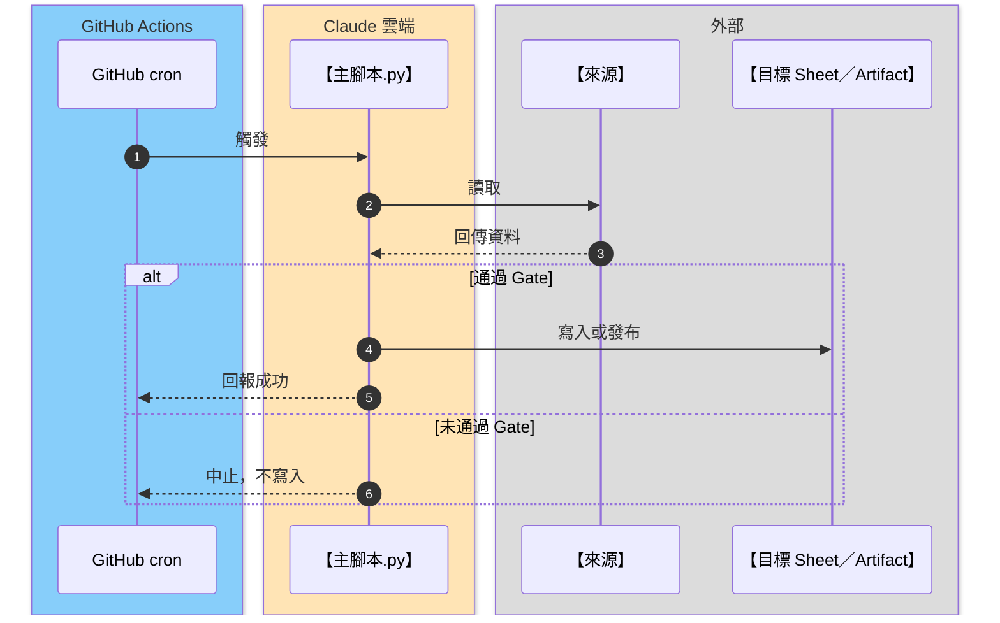

# [工作流名稱]（起手範本）

> 複製本檔為新工作流（例如 `daily-sync.md`），再依 [`_visualization-standard.md`](_visualization-standard.md) 填寫。
> 填寫完成後刪除所有 `【】` 提示文字。

---

## 概覽卡

- **流程 ID**：`【S1／T1／A1 或 C1 等】`
- **平台**：`【GitHub Actions／Claude 雲端／手動】`
- **觸發時機**：`【平日 09:00 台北時間】`

## 觸發

- `【cron 0 1 * * 1-5（UTC，即台北 09:00）】`
- `【手動：指令或單行 prompt】`

## 技能與腳本

- ● `【主責技能】`：`【腳本名稱與用途】`
- ○ `【被引用的共用模組】`：`【由哪個腳本引入】`

## 讀取

- `【來源一：路徑、分頁或網址】`
- `【來源二】`

## 寫入／影響

- `【目標一：範圍與欄位】`
- 只讀流程請寫：無

## 產出

- `【Artifact、Sheet、PR 或報告】`

## Secrets

- `【SECRET_NAME】`（只列名稱）

## 門檻（Gate）

- `【條件一：例如 rows ≥ 100】`
- `【未過時的處置：例如不寫入，保留舊值】`

## 執行順序

## 備註

- `【執行限制，例如：不 commit、不 push】`
