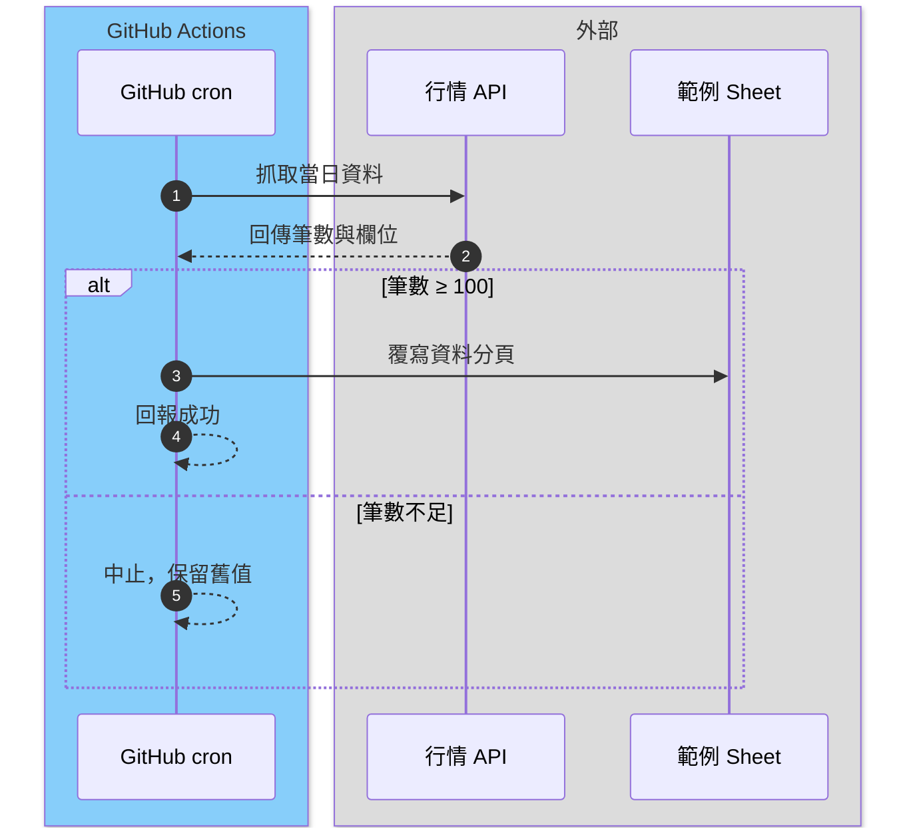

# 工作流可視化標準 (Workflow Visualization Standard)

本標準規定 `.claude/workflows/` 內每一份工作流規格（Schedule、Task、Automation）如何呈現「何時啟動、用哪些技能與腳本、讀寫什麼、產出什麼、在哪裡會停下」。目的是讓人與 Agent 只看一份文件，就能判斷一條流程的全貌。

起手範本見 [`_diagram-starter.md`](_diagram-starter.md)，新流程請複製該檔再填寫。

---

## 1. 適用範圍

- 所有 `.claude/workflows/*.md`，**不含**以底線開頭的範本檔（`_template-workflow.md`、`_visualization-standard.md`、`_diagram-starter.md`）。
- 登記總表 `workflow-registry.md` 只記一行摘要與指向；可視化內容一律寫在工作流自己的檔案內，**不另建圖檔**。

## 2. 必備區段（依序排列）

每份工作流檔案必須包含下列 8 個區段。缺一即視為未通過可視化檢查。

| 順序 | 區段 | 內容要求 |
| :-- | :-- | :-- |
| 1 | **概覽卡** | 流程 ID（如 `S1`、`C2`）、名稱、平台、觸發時機（含台北時間） |
| 2 | **觸發** | 每一種觸發方式各一行：cron（註明是 UTC 還是台北）、手動指令、事件、單行呼叫 prompt |
| 3 | **技能與腳本** | 每個技能一行。**主責**（流程直接呼叫）標 `●`，**被引用**（腳本內 import 或 sys.path 引入）標 `○` |
| 4 | **讀取** | 來源的名稱與位置（檔案路徑、試算表分頁、外部網站、Artifact） |
| 5 | **寫入／影響** | 會被改寫的目標與範圍（分頁與欄位、檔案路徑）。只讀流程寫「無」 |
| 6 | **產出** | 對外可見的結果：Artifact、Sheet、PR、報告。暫存檔不列入產出 |
| 7 | **Secrets** | 只列**名稱**，例如 `GCP_SA_KEY`，**不得**出現值、webhook 網址或 token 片段 |
| 8 | **門檻（Gate）與執行順序圖** | 門檻逐條列出判定條件與未過時的處置；執行順序圖見第 3 節 |

區段 8 之後可加「備註」，寫不屬於上述任一類、但執行者必須知道的限制（例如「不 commit、不 push」）。

## 3. 執行順序圖（Mermaid）

- 每個工作流**只有一張**圖，使用 Mermaid `sequenceDiagram`，直接寫在工作流的 Markdown 內。
- 必須 `autonumber`，讓回報與告警能指出第幾步。
- **參與者分組**：依平台用 `box` 分組，顏色固定如下：

  | 平台 | `box` 語法 | 含義 |
  | :-- | :-- | :-- |
  | GitHub Actions | `box LightSkyBlue GitHub Actions` | 自動排程或 CI |
  | Claude 雲端 | `box Moccasin Claude 雲端` | 雲端排程與發布 |
  | 手動／會話 | `box Gainsboro 手動` | 人或本機 Agent 觸發 |

- **參與者命名**：腳本用 `.py` 檔名，試算表用「Sheet」結尾，Artifact 用「Artifact」結尾，外部來源用網站或服務名稱。
- **門檻必須畫出來**：用 `alt ... else ... end` 表示 Gate。未過時的分支要寫出終止或保留舊值，不得省略。
- **失敗路徑必須明確**：寫入外部目標前的最後一步一定要標示是否會覆寫。
- **不得包含金鑰、網址參數或個人資料**。
- 一張圖建議不超過 12 則訊息；超過時拆成兩個工作流，而不是把圖縮小。

## 4. 版面與閱讀順序

1. 概覽卡與觸發放在檔案最前面，讓人先知道「什麼時候跑」。
2. 技能與腳本、讀取、寫入、產出依照「由輸入到輸出」的順序排列。
3. 執行順序圖放在門檻之後，作為詳細說明，不取代前面的表格。
4. 每個區段用二級標題（`##`）；不得把多個區段合併成一段文字。

## 5. 一致性檢查

提交前，工作流作者需自行確認：

- [ ] 第 2 節的 8 個區段都存在，且順序正確。
- [ ] 技能清單中的每個腳本路徑都存在於 repo 內。
- [ ] 圖中的每個 `alt` 都對應到門檻表中的一條條件。
- [ ] Secrets 區段只有名稱，沒有值。
- [ ] `workflow-registry.md` 的對應列與工作流檔案的觸發時機一致。

## 6. 範例

以下是依本標準寫成的一個最小範例（數值與名稱為虛構，不含任何 ID 或金鑰）。

## 7. 工廠模擬頁（選用）

專案想要一張總覽圖時，可用 `workflow-factory` 技能（`.claude/skills/workflow-factory/`）把全部工作流畫成「工廠平面圖」：觸發（進料口）→ 技能（機台）→ 產出（倉庫）。它是第 2 節 8 個區段的**衍生品**，不取代各工作流檔內的圖表。

**資料來源與自動對齊**

- 流程 ID、名稱、平台、觸發時機取自 `workflow-registry.md`；主責 `●` 與被引用 `○` 的技能取自各規格檔「技能與腳本」區段。因此第 2 節的區段 1、3 寫得越規矩，工廠頁越不需要人工維護。
- 機台顏色與簡稱、倉庫清單、產出路線等 repo 內沒有結構化來源的資訊，放在 `references/workflow-factory-data.json`（策展層），與登記表在同一個 PR 更新。
- 工廠資料與 repo 不一致時，產生器列在 `drift`，**只回報、不自行改資料檔**。`--strict` 可在 CI 或本機把 drift 當成失敗。

**版面規則**

- 觸發欄固定三種平台：GitHub 排程（藍）、Claude 排程（橘）、手動與會話（紫），與第 3 節的 `box` 配色一致。
- 機台上限 9 台（3×3），倉庫上限 15 個；超過時拆分技能或合併倉庫，不縮小字級。
- 沒有登記技能的流程（人工作業、純 CI）在頁面上以「未登記技能」呈現，仍可點選。
- 頁面只放名稱，不放金鑰、試算表或 Drive ID、個人資料；Artifact 網址寫在工作流規格，不寫進頁面。
- 想看範例與排程規格：[`workflow-factory.md`](workflow-factory.md)。

**新增工作流時的檢查**

- [ ] 登記表新增一列，規格檔含「技能與腳本」區段。
- [ ] `workflow-factory-data.json` 的 `ROWS`、`OUTS` 已補上；新技能已加進 `SK`，新產出已加進 `OUT`。
- [ ] `workflow_factory.py build factory.html --strict` 的 `drift` 為空。

## 8. 變更紀錄

- `2026-10-31`：初版。依 Investment_Tracker 工作流儀表板的版面，抽出固定區段、平台配色與 Mermaid 執行順序圖的規則。
- `2026-11-10`：新增第 7 節「工廠模擬頁」。依 Investment_Tracker 的工作流工廠（資料檔＋模板＋產生器、drift 回報、每日重產）抽出通用規則；專案專屬的機台、倉庫、流程路線與 Artifact 網址留在各專案資料檔。
