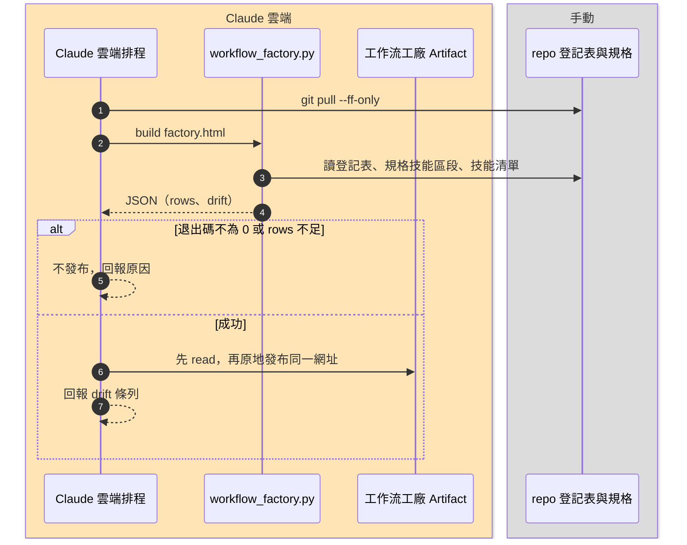

# 工作流工廠更新 標準作業程序 (SOP)

本工作流讓「工作流工廠」模擬頁依 repo 現況定時重產並原地更新。規格收斂於 Git REPO 作為單一真實來源（SSOT）；產生頁面的邏輯在 `workflow-factory` 技能。

> 📐 本檔依 [`_visualization-standard.md`](_visualization-standard.md) 撰寫；其中的 `【】` 為各專案需自行填寫的位置。

---

## 概覽卡

- **流程 ID**：`S2`
- **名稱**：工作流工廠更新
- **平台**：Claude 雲端
- **觸發時機**：每日 23:10（台北時間）；工作流規格、登記表或技能有異動後，也可手動觸發

## 觸發

- Claude 雲端排程，單行呼叫 prompt：

  ```text
  git pull --ff-only origin main，讀取並執行 .claude/workflows/workflow-factory.md，完成後依規格回報。
  ```

- 手動：使用者說「更新工作流工廠」

## 技能與腳本

- ● `workflow-factory`：`workflow_factory.py build`（產生頁面並回報 drift）

## 讀取

- `.claude/workflows/workflow-registry.md`（流程 ID、平台、觸發時機）
- 各工作流規格檔的「技能與腳本」區段
- `.claude/skills/*/SKILL.md`（技能清單）
- `.claude/skills/workflow-factory/references/workflow-factory-data.json`（策展資料）

## 寫入／影響

- 無。`factory.html` 只存暫存目錄，不進 git，不改 repo，不寫任何外部資料。

## 產出

- Artifact：工作流工廠（原地更新同一網址）。網址由各專案記錄在排程設定：`【Artifact 網址】`

## Secrets

- 無

## 門檻（Gate）

- 腳本退出碼不為 0，或 `rows` 少於登記表的流程數：不發布，回報原因。
- `drift` 非空：不擋發布，頁面照常更新，但回報中逐項列出，由使用者同意後開 PR 更新資料檔。

## 執行順序



## 備註

- 不 commit、不 push；策展資料落後 repo 時只回報，不自行改資料檔。
- 發布時重發不傳 `icon`，沿用既有圖示。
